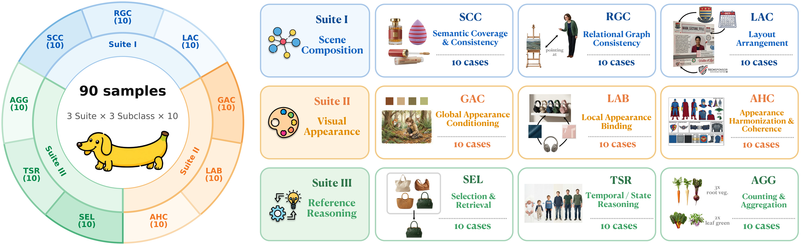
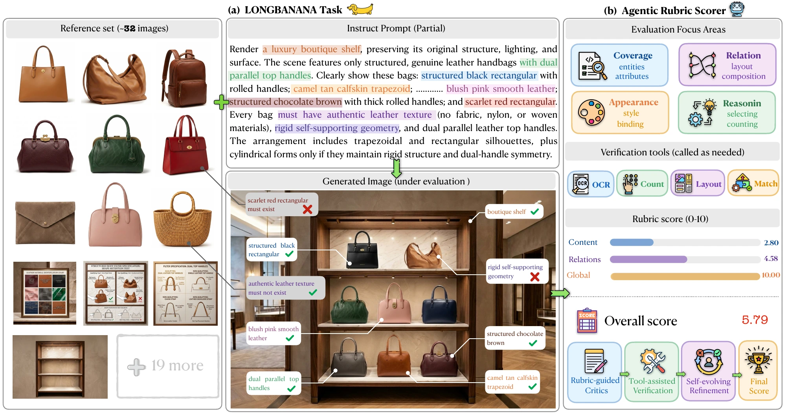

#  LongBanana

## An Expert-Verified Benchmark for Long-Context Multi-Reference Image Synthesis

<p align="center">
  <a href="https://klingairesearch.github.io/LongBanana/"></a>
  <a href="https://klingairesearch.github.io/LongBanana/gallery/"></a>
  <a href="#paper-and-citation"></a>
  <a href="https://huggingface.co/datasets/Kwai-Kolors/LongBanana"></a>
</p>

**90 tasks per release · 9 categories · 32 reference images per task · graph-grounded evaluation**

LongBanana evaluates whether image-generation systems can retrieve dispersed visual
evidence, reject distractors, bind entities and relations correctly, and compose
one coherent final image from many references. It measures reference-grounded
correctness beyond visual plausibility or a single holistic quality score.

This repository provides **LongBanana-Gen** and **LongBanana-Eval** with sandboxed
**OpenClaw, Codex, and Claude Code** integrations, optional visual-specialist
judging, and a direct Gemini VLM judging baseline. Planning and judging models
are independently configurable using Gemini, GPT, or Claude. Image generation
uses **Gemini 3.1 Flash Image**.



## Benchmark

Each task pairs a synthesis instruction and a heterogeneous reference inventory
with a graph-grounded checklist. The entity–relation graph connects required
content, local bindings, relations, and scene-wide constraints to atomic,
visually verifiable evaluation items.

| Suite | Category | Capability | Tasks per release |
| --- | --- | --- | ---: |
| Scene Composition | SCC | Semantic Coverage & Consistency | 10 |
| Scene Composition | RGC | Relational Graph Consistency | 10 |
| Scene Composition | LAC | Layout Arrangement Consistency | 10 |
| Visual Appearance | GAC | Global Appearance Conditioning | 10 |
| Visual Appearance | LAB | Local Appearance Binding | 10 |
| Visual Appearance | AHC | Appearance Harmonization & Coherence | 10 |
| Reference Reasoning | SEL | Selection & Retrieval | 10 |
| Reference Reasoning | TSR | Temporal / State Reasoning | 10 |
| Reference Reasoning | AGG | Counting & Aggregation | 10 |

The taxonomy describes each task's dominant demand. The three grading dimensions
used across tasks are **Content Fidelity**, **Relational Binding**, and **Global
Constraint Satisfaction**.

[](assets/fig1_task_overview_cr_2000.webp)

## Generation and Evaluation

**LongBanana-Gen** lets an agent inspect references, plan, call the image backend,
and revise intermediate outputs. The OpenClaw **RPR** workflow combines ReAct,
Plan–Exec, and Reflect. Codex and Claude Code use their native tools and image
viewing with a shared generation prompt and Gemini MCP interface. Backend guidance
is available for optional reading. Agents decide how many generation or editing
calls to make within the configured execution timeout.

[](assets/longbanana-gen.pdf)

**LongBanana-Eval** judges individual checklist obligations against a generated
candidate and the references bound to that check. Bindings come from the dataset,
not an agent's retrieval decision. An agent may decide which supplied references
to open. OpenClaw optionally delegates evidence gathering to OCR,
detection/counting, layout, and identity specialists.

| Supported execution mode |
| --- |
| Direct VLM (Gemini) |
| OpenClaw |
| Codex |
| Claude Code |

Agent tasks run in Linux Bubblewrap sandboxes with read-only inputs and isolated
workspaces. Generation agents cannot access evaluation checklists, simulated
targets, or prior scores. Upstream credentials remain in the supervisor. Networking
is shared: Bubblewrap isolation is not a network-domain allowlist. See
[architecture](docs/architecture.md) for execution and access boundaries.

### Scoring

Labels use **Fail = 0**, **Uncertain = 1**, and **Pass = 2**:

```text
Case score = 100 × sum(item scores) / (2 × number of items)
Category score = mean(case scores in the category)
Overall score = mean(all case scores)
```

These are unweighted case-mean scores. Invalid responses have no numeric score;
incomplete runs report coverage and provisional scores. Report the dataset release,
Judge configuration, and any missing-value policy alongside results. Difficulty-
weighted scores require an identified weight file and evaluation cohort. Historical
paper results use their stated aggregation and must not be relabelled as results
for another dataset release or execution profile.

## Datasets

Download the datasets from [Hugging Face](https://huggingface.co/datasets/Kwai-Kolors/LongBanana).
Dataset archives are distributed separately from code.

| Release | Cases | References | Evaluation checks |
| --- | ---: | ---: | ---: |
| `open_v1` | 90 | 2,880 | 4,670 |
| `open_v1p5` | 90 | 2,880 | 5,170 |

`open_v1p5` extends `open_v1` with 90 additional tasks featuring non-overlapping
content. Both releases share the same data format, task taxonomy, and generation
and evaluation workflows, allowing users to expand their experiments with the
same pipeline. Select a release with `DATASET_MANIFEST`.

## Installation and Configuration

Use **Linux, Python 3.11+, Node.js, and Bubblewrap**, plus a supported agent runtime.
The fixed OpenClaw build is included in `openclaw-runtime/`; Codex and Claude Code
are obtained separately. See the [runtime guide](docs/runtimes.md) for dependency
setup and pinned versions. No private repository is required.

The `main` branch contains the sandboxed implementation.

```bash
git clone https://github.com/KlingAIResearch/LongBanana.git
cd LongBanana
python -m pip install -e .
npm ci --prefix mcp/image_gen
```

Existing Python and MCP dependencies may be reused instead of installed. No run
automatically installs an agent runtime or changes the environment. Switching a
code branch does not select or convert a dataset.

Copy an example configuration and supply local paths through environment variables:

```bash
export DATASET_MANIFEST=/path/to/open_v1/manifest.json
export RUNTIME_MANIFEST=/path/to/runtimes.json
export BWRAP_PATH=/path/to/bwrap
export MCP_MODULES="$PWD/mcp/image_gen/node_modules"
```

| Configuration | Default model interface | Credentials |
| --- | --- | --- |
| [Codex](examples/codex.json) | OpenAI Responses | `OPENAI_API_KEY`, `OPENAI_MODEL` |
| [Claude Code](examples/claude-code.json) | Anthropic Messages | `ANTHROPIC_API_KEY`, `ANTHROPIC_MODEL` |
| [Gemini model fragment](examples/gemini-model.json) | Google Gemini, with explicit protocol conversion | `GEMINI_API_KEY`, `GEMINI_MODEL` |
| [OpenClaw](examples/openclaw.json) | Configurable provider interface | See the example and runtime guide |
| [Direct Gemini VLM](examples/direct-vlm.json) | Google Gemini | `GEMINI_API_KEY`, `GEMINI_MODEL` |

Generation also requires `GEMINI_API_KEY` for `gemini-3.1-flash-image`. Examples
target official provider endpoints; select model IDs available to your account.
Keep credentials in environment variables and do not commit local configurations.
See [running experiments](docs/running.md) for the runtime manifest, OpenClaw
settings, concurrency, and timeout options.

## Generate Images

Validate the dataset, then inspect a single case or run the full release:

```bash
python -m longbanana validate-data "$DATASET_MANIFEST" --evaluation
python -m longbanana generate --config examples/codex.json --output runs/gen --case LAC-001 --dry-run
python -m longbanana generate --config examples/codex.json --output runs/gen --resume
```

Use `examples/claude-code.json` or `examples/openclaw.json` for another agent.
`--dry-run` checks inputs and runtime paths without API calls. Accepted outputs are
listed in `runs/gen/candidates.json`. Resume reuses valid outputs only when input,
configuration, code, runtime, and output fingerprints match.

## Evaluate Generated Images

Generation and judging can use different model configurations. Evaluate the same
candidate manifest with an agentic Judge and the direct baseline:

```bash
python -m longbanana judge --config examples/codex.json --candidates runs/gen/candidates.json --output runs/judge --resume
python -m longbanana judge-direct --config examples/direct-vlm.json --candidates runs/gen/candidates.json --output runs/direct --resume
```

Choose another agent configuration to change the Judge. OpenClaw's `subagents`
setting enables or disables visual specialists. Outputs include `experiment.json`,
per-task records in `results/`, attempts, and `summary.json`. Keep a separate output
directory for each configuration. See [reproducibility](docs/reproducibility.md).

## Repository Structure

```text
src/longbanana/           Unified CLI, sandbox, transports, generation and judging
src/openclaw_longbanana/  Retained OpenClaw generation and Judge workflows
mcp/image_gen/           Gemini image-generation MCP server
openclaw_skills/         Visual Judge specialist instructions
examples/                Official-provider configuration examples
docs/                    Architecture, dataset format and execution guides
tests/                   Offline tests
```

Run offline tests with `python -m unittest discover -s tests -v`.
[Release packaging](docs/releasing.md) documents the source/data separation.

## Acknowledgments and License

LongBanana builds on the OpenClaw, Codex, Claude Code, Bubblewrap, and Model Context
Protocol ecosystems. Code and accompanying documentation are licensed under
[MIT](LICENSE). Retained third-party notices are in [NOTICE.router](NOTICE.router)
and [NOTICE.openclaw](NOTICE.openclaw); separately installed runtimes retain their
own licenses. [Artwork sources](assets/README.md)
identify the project figures and third-party brand marks.

The `open_v1` and `open_v1p5` datasets are licensed separately under
[CC BY 4.0](https://creativecommons.org/licenses/by/4.0/). Each archive includes the
full license and attribution information.

## Paper and Citation

**arXiv Paper: Coming soon.** Visit the [Project Page](https://klingairesearch.github.io/LongBanana/)
for the research overview. Please cite LongBanana when using the benchmark:

```bibtex
@misc{cao2026longbanana,
  title={LongBanana: An Expert-Verified Benchmark for Long-Context Multi-Reference Image Synthesis},
  author={Cao, Haoxiang and Zhang, Yuxuan and Du, Penghui and others},
  year={2026},
  url={https://github.com/KlingAIResearch/LongBanana}
}
```
